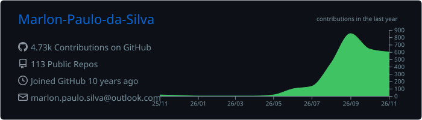
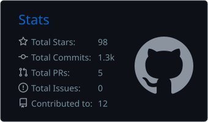
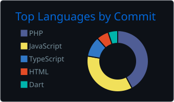

🇺🇸 **English** · [🇧🇷 Português](README.pt-BR.md)

**Code that turns into business results. Applied AI, no hype.**

  
  
  
  

---

### About me

Back-end engineer at [ImobiBrasil](https://www.linkedin.com/company/imobibrasil/), building the platform real estate agencies use to run their websites, leads and sales.

- **Day to day:** PHP, Laravel, MySQL, REST APIs, Docker, performance and tracking (Meta, TikTok, Clarity pixels).
- **Now:** applying AI where it moves a number: WhatsApp automations, lead routing, n8n flows and LLM agents for small businesses.
- **Also:** I document what works (and what doesn't) with AI in business on [Instagram](https://www.instagram.com/marlonpaulo.ia).
- **Education:** Systems Analysis and Development, Fatec Presidente Prudente.

### Tech stack

  

### What I'm building

| Area | What | Stack |
|---|---|---|
| Real estate SaaS | Lead routing, sales pipeline and website performance at ImobiBrasil (private) | PHP · Laravel · MySQL |
| AI automation | WhatsApp agents and n8n flows for local businesses | Node.js · n8n · LLM APIs |
| Side projects | Personal finance and sports-court replay apps | Python · Docker |

### Open-source projects

| Project | Description | Stack |
|---|---|---|
| [**CRUD-MVC-PHP**](https://github.com/Marlon-Paulo-da-Silva/CRUD-MVC-PHP) | Custom MVC in pure PHP: own router, middlewares, sessions, admin area and REST API (v1) | PHP · MySQL |
| [**TikTok-Clone-ReactNative**](https://github.com/Marlon-Paulo-da-Silva/TikTok-Clone-ReactNative)  | Full-screen video feed | React Native · Expo |
| [**SabeOfertas**](https://github.com/Marlon-Paulo-da-Silva/SabeOfertas) | Real-time deals finder for people walking around retail areas | React · React Native · Node.js |
| [**Buscar-valores-selic**](https://github.com/Marlon-Paulo-da-Silva/Buscar-valores-selic) | Brazil's Selic rate for a date range via the Central Bank open data API | React |

### GitHub analytics

<picture>
  <source media="(prefers-color-scheme: dark)" srcset="https://raw.githubusercontent.com/Marlon-Paulo-da-Silva/Marlon-Paulo-da-Silva/output/github-snake-dark.svg" />
  
</picture>
