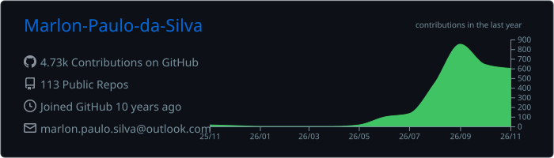
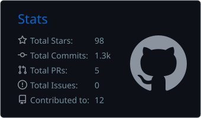
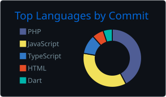

[🇺🇸 English](README.md) · 🇧🇷 **Português**

**Código que vira resultado no negócio. IA aplicada, sem hype.**

  
  
  
  

---

### Sobre mim

Engenheiro back-end na [ImobiBrasil](https://www.linkedin.com/company/imobibrasil/), construindo a plataforma que imobiliárias usam para tocar site, leads e vendas.

- **No dia a dia:** PHP, Laravel, MySQL, APIs REST, Docker, performance e rastreamento (pixels da Meta, TikTok e Clarity).
- **Agora:** aplicando IA onde ela mexe em número: automações no WhatsApp, distribuição de leads, fluxos no n8n e agentes com LLM para pequenos negócios.
- **Também:** mostro o que funciona (e o que não funciona) com IA nos negócios no [Instagram](https://www.instagram.com/marlonpaulo.ia).
- **Formação:** Análise e Desenvolvimento de Sistemas, Fatec Presidente Prudente.

### Tecnologias

  

### No que estou trabalhando

| Área | O quê | Stack |
|---|---|---|
| SaaS imobiliário | Distribuição de leads, funil de vendas e performance de sites na ImobiBrasil (privado) | PHP · Laravel · MySQL |
| Automação com IA | Agentes de WhatsApp e fluxos n8n para negócios locais | Node.js · n8n · APIs de LLM |
| Projetos pessoais | App de finanças pessoais e replay de quadras esportivas | Python · Docker |

### Projetos open source

| Projeto | Descrição | Stack |
|---|---|---|
| [**CRUD-MVC-PHP**](https://github.com/Marlon-Paulo-da-Silva/CRUD-MVC-PHP) | MVC próprio em PHP puro: roteador, middlewares, sessões, área admin e API REST (v1) | PHP · MySQL |
| [**TikTok-Clone-ReactNative**](https://github.com/Marlon-Paulo-da-Silva/TikTok-Clone-ReactNative)  | Feed de vídeos em tela cheia | React Native · Expo |
| [**SabeOfertas**](https://github.com/Marlon-Paulo-da-Silva/SabeOfertas) | Ofertas em tempo real para quem passa por áreas comerciais | React · React Native · Node.js |
| [**Buscar-valores-selic**](https://github.com/Marlon-Paulo-da-Silva/Buscar-valores-selic) | Taxa Selic por período via API de dados abertos do Banco Central | React |

### Estatísticas

<picture>
  <source media="(prefers-color-scheme: dark)" srcset="https://raw.githubusercontent.com/Marlon-Paulo-da-Silva/Marlon-Paulo-da-Silva/output/github-snake-dark.svg" />
  
</picture>
